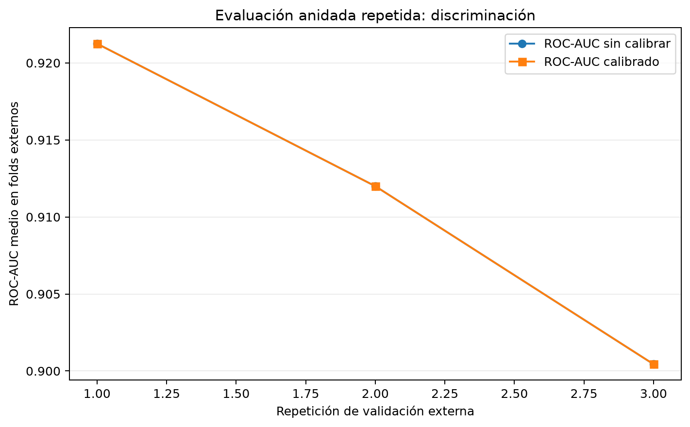
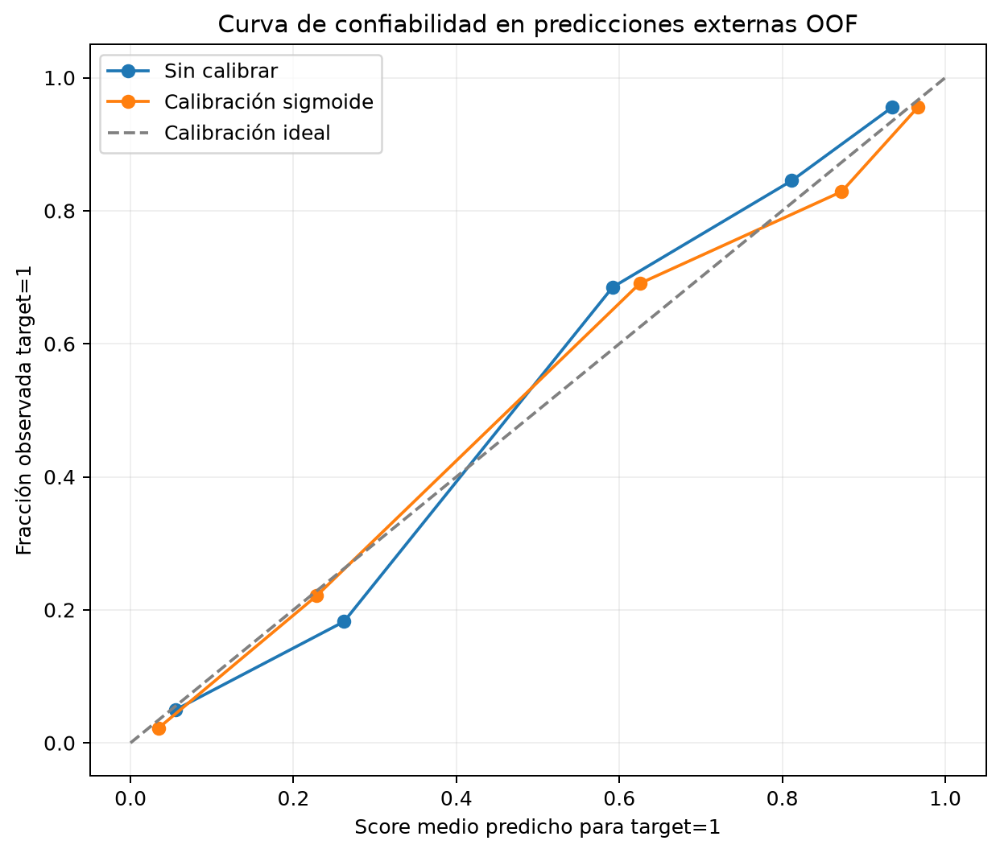
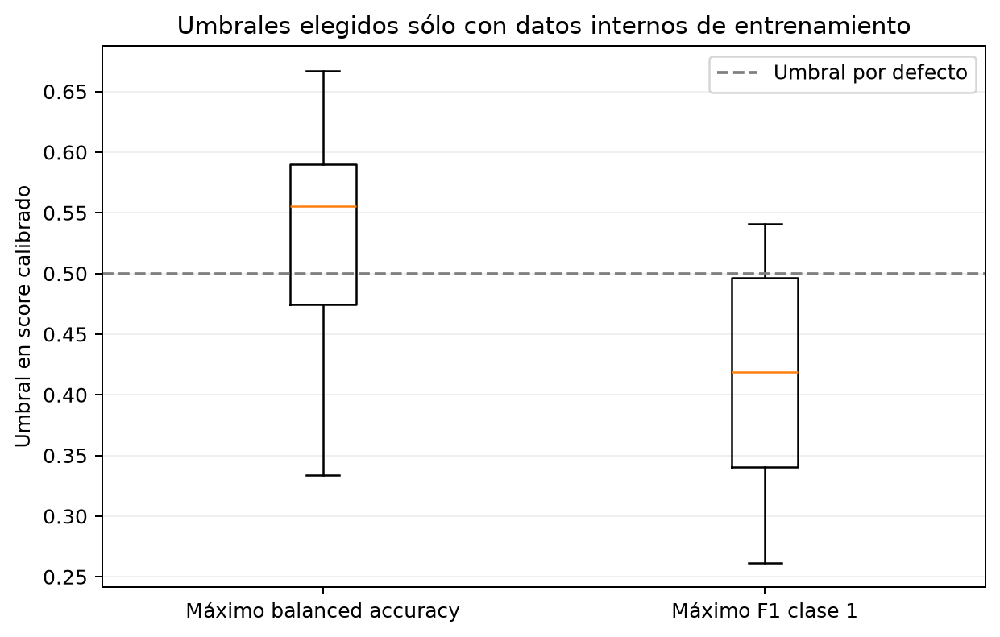

# Evaluación robusta del modelo

## Alcance y advertencia

Este análisis complementa la evaluación original de una única partición train/test. Ejecuta selección anidada repetida, calibración sigmoide y selección de umbral dentro de entrenamiento. No representa validación clínica ni evaluación en una cohorte independiente. La clase positiva se interpreta como `target=1` según la ficha de Kaggle, declaración del proveedor sin verificación clínica independiente ([ficha Kaggle](https://www.kaggle.com/datasets/johnsmith88/heart-disease-dataset)).

La auditoría local confirma que `data/raw/heart.csv` coincide tabularmente con el archivo publicado por Kaggle. Contiene 1.025 filas, 723 duplicados exactos y 302 registros únicos; tras deduplicar, 138 tienen `target=0` y 164 `target=1`. No se detectaron predictores idénticos asociados a etiquetas distintas. La ficha de Kaggle y los dominios observados presentan discrepancias para categorías como `ca` y `thal`; no se pudo trazar cada fila hasta la base UCI original. Por tanto, el resultado depende de los códigos y etiquetas publicados con esta copia.

La página UCI describe su conjunto Cleveland como 303 casos y una variable original `num` con valores 0–4. No se ha demostrado que este archivo de Kaggle sea una transformación fila a fila de esos casos ([UCI Heart Disease](https://archive.ics.uci.edu/dataset/45/heart%2Bdisease)).

## Método

Se usó validación cruzada anidada estratificada: 3 repeticiones de 5 folds externos y 3 folds internos. En cada entrenamiento externo se seleccionó familia e hiperparámetros por ROC-AUC interno entre regresión logística (one-hot y RobustScaler para cuantitativas) y XGBoost one-hot de poca profundidad. La evaluación externa mide el procedimiento completo de selección, no un modelo elegido mirando esos folds. Esta separación reduce el sesgo optimista de seleccionar y evaluar sobre los mismos datos ([documentación scikit-learn sobre CV anidada](https://scikit-learn.org/stable/auto_examples/model_selection/plot_nested_cross_validation_iris.html)).

La calibración sigmoide se ajustó dentro de cada entrenamiento externo. Los umbrales alternativos se eligieron con predicciones calibradas fuera de fold obtenidas dentro del entrenamiento externo, y luego se midieron en el fold externo. Se compararon el umbral 0,5, el umbral que optimiza balanced accuracy y el que optimiza F1 de `target=1`. La selección de umbral depende del costo relativo de errores y cambia precisión/recall; estos datos no definen costos clínicos ([ajuste de umbral](https://scikit-learn.org/stable/modules/classification_threshold.html)). La evaluación de calibración emplea Brier y log-loss además de curvas de calibración ([calibración de probabilidades](https://scikit-learn.org/stable/modules/calibration.html)).

## Resultados

Las cifras son la media de las métricas por repetición (cada repetición promedia sus cinco folds externos); la desviación estándar que acompaña al ROC-AUC es la desviación entre esas tres medias. Las repeticiones comparten observaciones, por lo que esa dispersión es descriptiva, no un intervalo de confianza con muestras independientes.

| Métrica externa | Sin calibrar | Sigmoide | Lectura |
|---|---:|---:|---|
| ROC-AUC | 0,9112 ± 0,0104 | 0,9112 ± 0,0104 | Sin cambio; transformación monótona conserva el orden. |
| Brier (menor es mejor) | 0,1197 | 0,1169 | Mejora pequeña en estos folds. |
| Log-loss (menor es mejor) | 0,3914 | 0,3745 | Mejora pequeña en estos folds. |
| Accuracy con umbral 0,5 | 0,8354 | 0,8398 | Cambio pequeño. |
| Balanced accuracy con umbral 0,5 | 0,8327 | 0,8366 | Cambio pequeño. |
| Recall clase 1 con umbral 0,5 | 0,8637 | 0,8739 | Sube; la especificidad baja de 0,8018 a 0,7993. |
| F1 clase 1 con umbral 0,5 | 0,8500 | 0,8551 | Cambio pequeño. |

El umbral que maximizó balanced accuracy dentro del entrenamiento promedió 0,5330. En los folds externos obtuvo balanced accuracy 0,8319, por debajo de 0,8366 con umbral calibrado 0,5. El umbral que maximizó F1 promedió 0,4163: aumentó recall externo a 0,8941, pero redujo especificidad a 0,7557 y balanced accuracy a 0,8249; el F1 externo (0,8514) no superó el 0,8551 de umbral 0,5. No hay base para recomendar esos umbrales como punto de operación.

La selección interna escogió regresión logística en 14/15 folds y XGBoost en 1/15. Esto señala que la logística merece consideración si se permite CPU; no prueba superioridad definitiva ni cambia el artefacto XGBoost GPU ya acordado para el proyecto. No se debe comparar directamente estas métricas con el test retenido de la evaluación original como si fueran la misma muestra o protocolo.

## Figuras reproducibles

Los valores completos por fold, repetición, observación externa y familia seleccionada están en `outputs/tables/nested_cv_*.csv`. La auditoría de procedencia está en `outputs/tables/auditoria_fuente_target.csv`. El notebook ejecutable es `notebooks/05_evaluacion_robusta_modelo.ipynb`; la implementación está en `src/robust_model_evaluation.py` y `src/source_audit.py`.

## Qué falta para afirmar generalización

No hay una cohorte independiente, autorizada y compatible dentro del repositorio, así que no se ejecutó validación externa. Para hacerlo se necesita una fuente con procedencia y permisos documentados, definición clínica verificable del desenlace, mapeo inequívoco de variables/categorías, momento de medición comparable y comprobación de que no hay solapamiento con los datos actuales. Si existen varias filas por paciente, la partición debe agruparse por paciente; el archivo actual no contiene ID para hacerlo ([validación cruzada por grupos](https://scikit-learn.org/stable/modules/cross_validation.html)). También se requiere acordar qué error tiene mayor costo antes de proponer un umbral.

Hasta contar con esas condiciones, estas métricas describen el rendimiento interno sobre una copia pequeña y duplicada del dataset. No son confiabilidad clínica ni desempeño esperado en pacientes reales.
