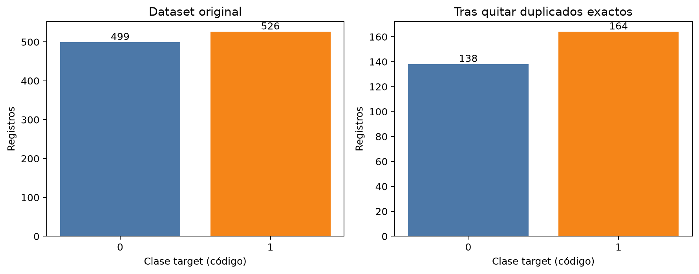
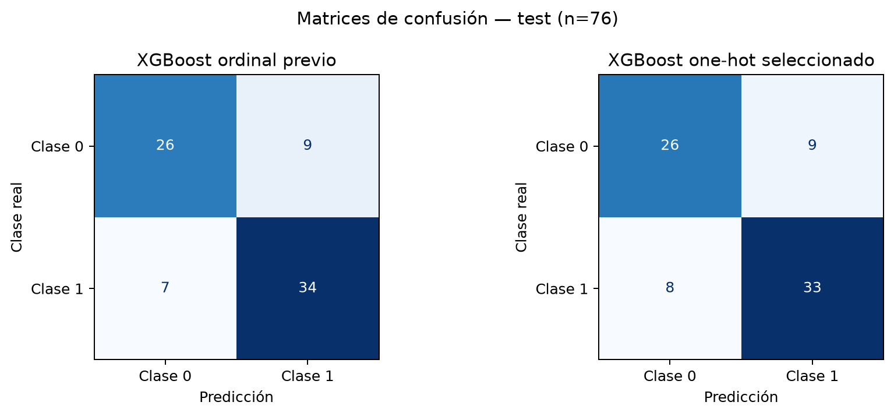
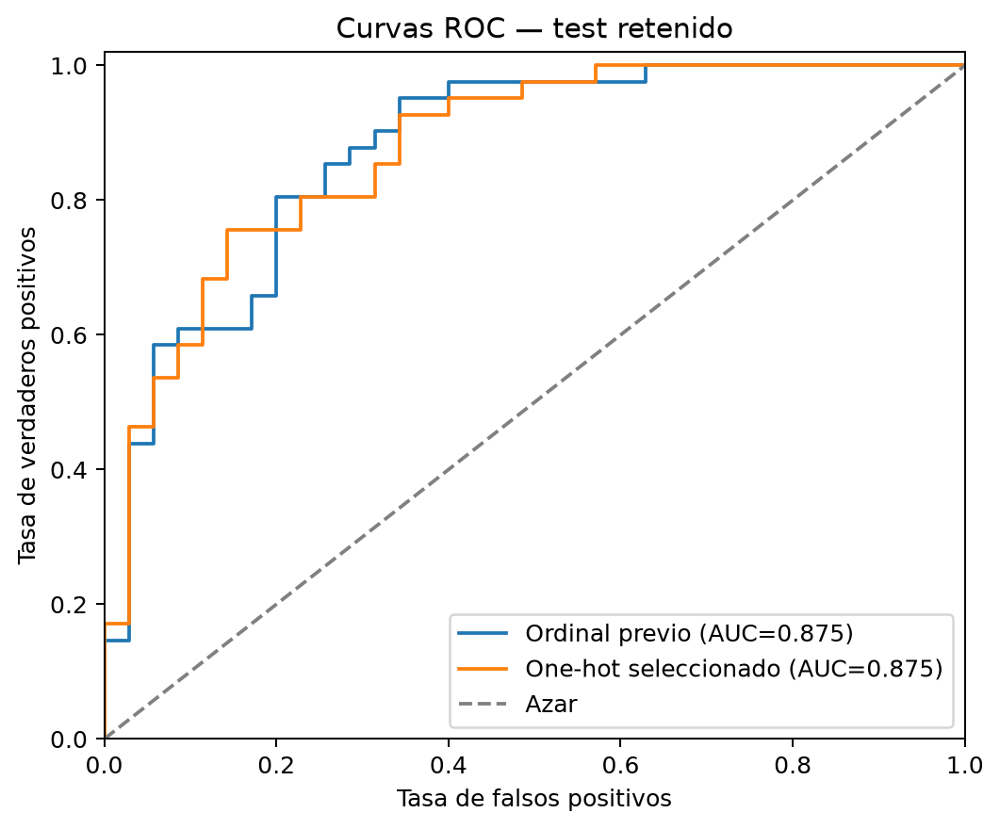
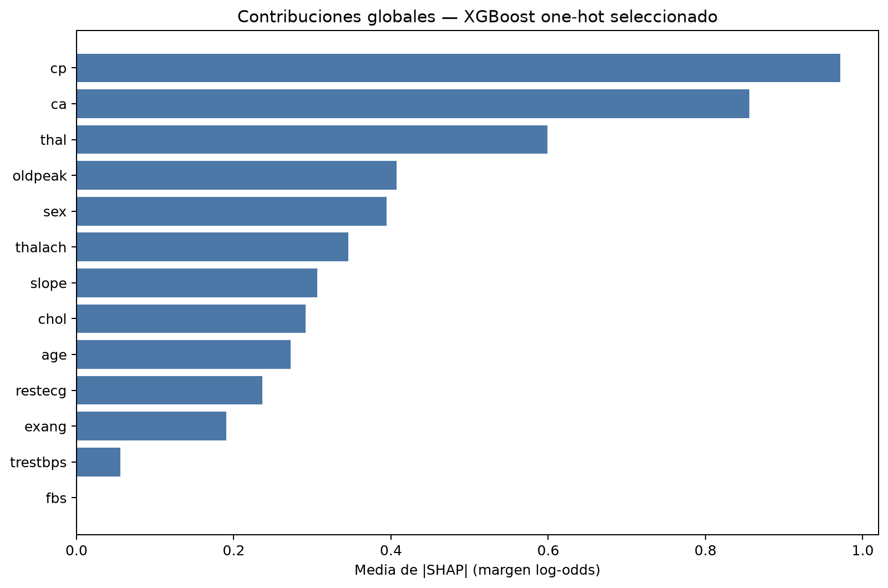
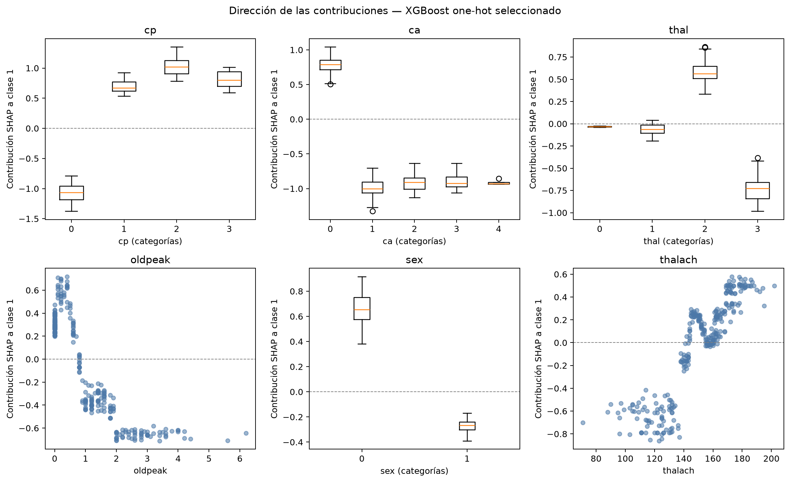
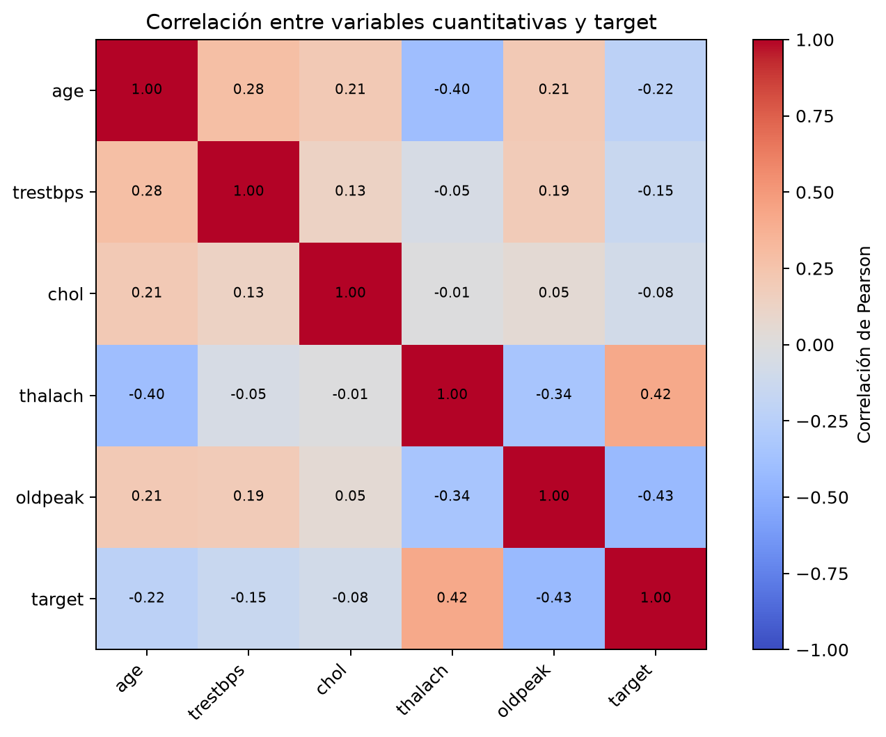
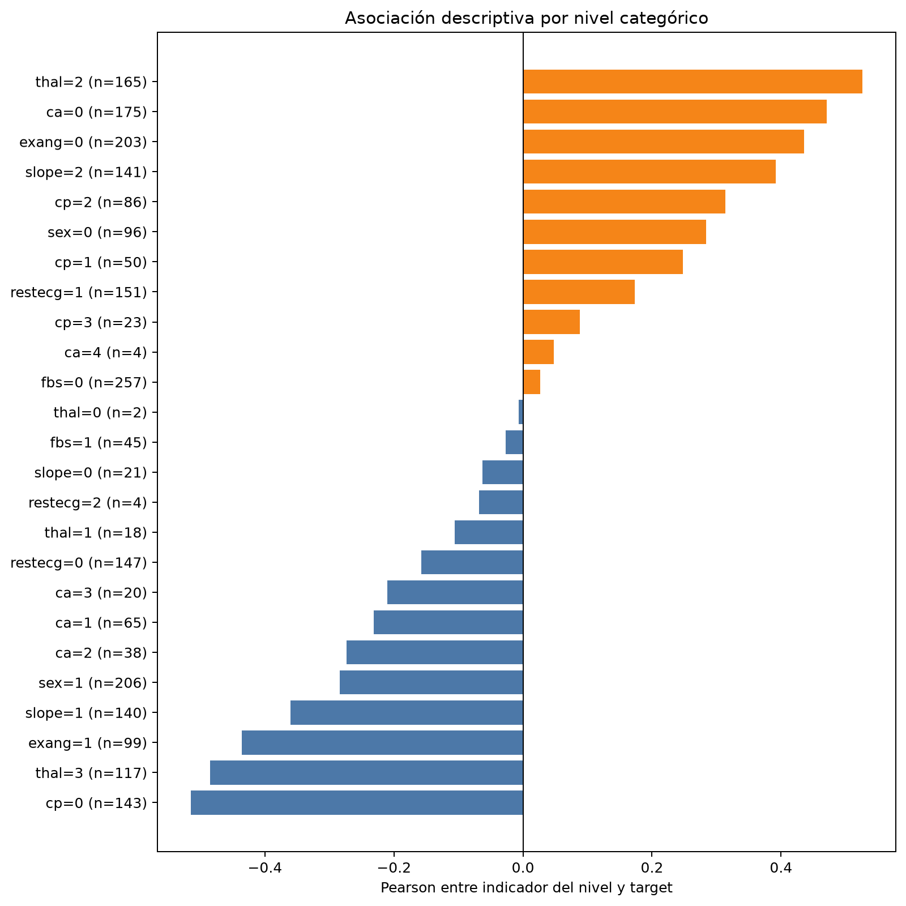
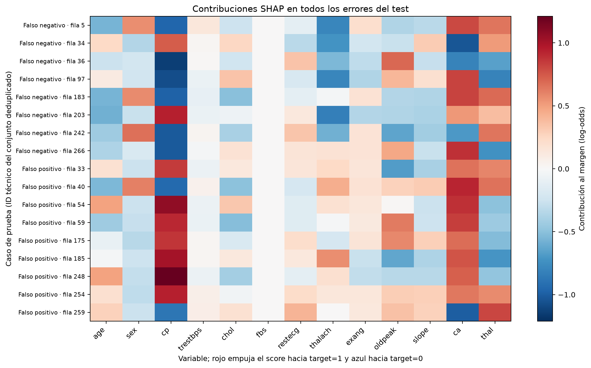
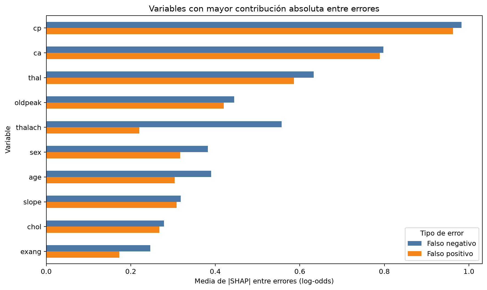
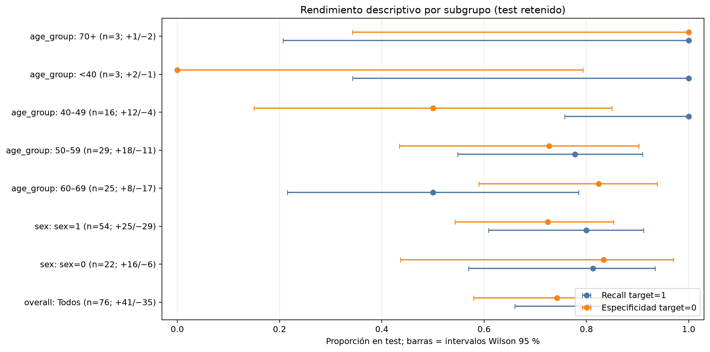

# Cómo se entrenó y qué explica el modelo

## Propósito y alcance

Este documento reúne la preparación, el entrenamiento, los resultados de prueba y las explicaciones de errores y subgrupos del prototipo XGBoost one-hot. Está pensado para que el proceso pueda revisarse paso a paso. Describe el comportamiento del modelo sobre la copia académica disponible; no demuestra causas clínicas, rendimiento en pacientes de otra población ni ausencia de sesgo.

La clase positiva se denomina `target=1` siguiendo la ficha del proveedor Kaggle. Esa declaración no equivale a una verificación clínica independiente. Las discrepancias observadas en categorías como `cp`, `slope`, `ca` y `thal` siguen siendo una limitación de interpretación.

## 1. Datos y preparación

El archivo original contiene 1.025 filas. Se encontraron 723 duplicados exactos sobre sus 14 columnas; se eliminaron antes de dividir para que copias idénticas no quedaran en entrenamiento y prueba. Quedaron **302 filas únicas**: 138 con `target=0` (45,7 %) y 164 con `target=1` (54,3 %). No se observaron valores nulos ni combinaciones idénticas de predictores con etiquetas distintas.

La distribución de clases global, después de deduplicar, no está marcadamente desbalanceada. Eso no significa que todos los grupos estén igual de representados: los códigos `sex=0` y `sex=1` tienen 96 y 206 filas únicas, respectivamente. No se aplicó sobremuestreo automático.



## 2. Cómo se entrenó

1. Se separaron 226 registros para entrenamiento y 76 para test mediante partición estratificada, con semilla 42.
2. En entrenamiento se compararon pipelines con validación cruzada estratificada de cinco folds y ROC-AUC. El preprocesamiento se ajusta dentro de cada pipeline/fold.
3. El artefacto elegido es XGBoost one-hot somero. Las variables categóricas (`sex`, `cp`, `fbs`, `restecg`, `exang`, `slope`, `ca`, `thal`) se codifican como indicadores; no se les impone una escala ordinal. Las cuantitativas (`age`, `trestbps`, `chol`, `thalach`, `oldpeak`) se dejan sin escalar para XGBoost.
4. El candidato somero usa 250 árboles, profundidad máxima 2, tasa de aprendizaje 0,04, `min_child_weight=3`, `subsample=0,9`, `colsample_bytree=0,9` y regularización L2 (`reg_lambda=2`). Se entrenó con CUDA en una NVIDIA RTX 4060. El artefacto se conserva por el requisito de ejecución GPU del proyecto; la comparación posterior de validación anidada también encontró que la regresión logística era una candidata fuerte, pero ésta se ejecuta en CPU.
5. El test se usó para la evaluación final de esta partición, no para ajustar las transformaciones del pipeline.

El modelo devuelve una clase usando el umbral predeterminado 0,5 y un score de clase 1 no calibrado. El ROC-AUC evalúa ordenamiento de scores a distintos umbrales; no es el porcentaje de casos correctamente clasificados.

## 3. Rendimiento en la prueba retenida

| Métrica XGBoost one-hot | Resultado | Conteo asociado |
|---|---:|---:|
| Accuracy | 0,776 | 59 de 76 correctos |
| Precisión de `target=1` | 0,786 | 33 de 42 predicciones positivas correctas |
| Recall de `target=1` | 0,805 | 33 de 41 positivos detectados; 8 falsos negativos |
| Especificidad de `target=0` | 0,743 | 26 de 35 negativos detectados; 9 falsos positivos |
| F1 de `target=1` | 0,795 | Resume precisión y recall de la clase 1 |
| ROC-AUC | 0,875 | Discriminación de scores en esta partición |

La matriz, con filas como clase real (0, 1) y columnas como predicción (0, 1), es `[[26, 9], [8, 33]]`.





El baseline ordinal tuvo un acierto más (60/76), pero asumía un orden numérico para códigos categóricos nominales. Ambos modelos obtuvieron ROC-AUC 0,875. La diferencia de accuracy se explica por un caso; no prueba superioridad estable del baseline.

## 4. Variables que influyen en las salidas

Se usaron contribuciones TreeSHAP de XGBoost. Para el pipeline one-hot, las columnas binarias creadas por el codificador se agruparon por variable original. La importancia global es la media de la magnitud absoluta SHAP en los 302 registros únicos; la unidad es margen log-odds, no porcentaje ni efecto causal.

| Variable | Contribución SHAP absoluta media (log-odds) | Lectura acotada |
|---|---:|---|
| `cp` | 0,971 | Mayor contribución media observada |
| `ca` | 0,855 | Alta contribución media observada |
| `thal` | 0,599 | Alta contribución media observada |
| `oldpeak` | 0,407 | Contribución intermedia |
| `sex` | 0,395 | Contribución intermedia; revisar cobertura por grupo |
| `thalach` | 0,346 | Contribución intermedia |
| `fbs` | 0,000 | El artefacto no usó esta variable en estos registros |





SHAP explica cuánto y en qué dirección una variable mueve el score calculado por el modelo, considerando sus combinaciones con otras variables. No explica por qué ocurrió el desenlace real, no prueba causalidad y no establece importancia clínica. La correlación y la asociación categórica también son descriptivas, no explicaciones causales.





## 5. Qué caracteriza los falsos negativos y positivos

Se analizaron los **17 errores del test** con sus contribuciones SHAP: 8 falsos negativos y 9 falsos positivos. En promedio, `cp`, `ca` y `thal` tuvieron las mayores contribuciones absolutas en ambos grupos. Entre los falsos negativos, el SHAP firmado promedio de `cp` fue −0,565 y el de `thalach` −0,514 log-odds; entre falsos positivos, `cp` fue +0,558 y `ca` +0,566. Son promedios de pocos casos: el mapa permite ver que la combinación y dirección varía entre registros.





Un predictor no “se equivoca” por sí solo: cada decisión surge de la combinación de entradas y de los límites aprendidos por el modelo. La explicación de error señala qué variables empujaron el score hacia la clase predicha, no cuál causó el error de etiqueta.

## 6. Desempeño por subgrupo y revisión de sesgo

Se calcularon recall de `target=1` y especificidad de `target=0` dentro del mismo test. Se acompañan con el número de casos de cada clase y límites Wilson del 95 % para mostrar la incertidumbre.

| Subgrupo | n | `target=1` / `target=0` | Recall | Especificidad | Observación |
|---|---:|---:|---:|---:|---|
| `sex=0` | 22 | 16 / 6 | 0,813 | 0,833 | Intervalos amplios |
| `sex=1` | 54 | 25 / 29 | 0,800 | 0,724 | Intervalos amplios; se solapan con `sex=0` |
| Edad 50–59 | 29 | 18 / 11 | 0,778 | 0,727 | Evidencia descriptiva |
| Edad 60–69 | 25 | 8 / 17 | 0,500 | 0,824 | Sólo 8 positivos en el test |
| Edad 40–49 | 16 | 12 / 4 | 1,000 | 0,500 | Soporte bajo para negativos |
| Edad <40 | 3 | 2 / 1 | 1,000 | 0,000 | Insuficiente para comparar |
| Edad 70+ | 3 | 1 / 2 | 1,000 | 1,000 | Insuficiente para comparar |



Los intervalos son amplios y los grupos extremos tienen muy pocos casos. No se puede concluir que exista o no exista sesgo a partir de esta prueba. La distribución global de clases equilibrada tampoco descarta sesgo de representación: `sex=0`/`sex=1` está representado en proporción 96/206 en los 302 registros únicos. Para comparar equidad se necesitarían una población objetivo definida, tamaños suficientes por grupo y validación más amplia.

## 7. Límites y conclusión

- La evaluación de errores y subgrupos se basa en una única partición de 76 casos y no prueba generalización.
- El dataset tiene sólo 302 registros únicos y no incluye identificador que permita verificar personas repetidas o particiones por paciente.
- La procedencia/semántica clínica de la etiqueta y varias codificaciones categóricas no se verificaron independientemente.
- Las contribuciones SHAP muestran comportamiento del algoritmo, no causalidad, validez clínica ni equidad.
- Los resultados respaldan un prototipo académico explicable a nivel de entradas y casos analizados, pero no un sistema clínico validado.

## Reproducción y artefactos

Desde la raíz del repositorio:

```powershell
uv sync
uv run jupyter notebook notebooks/04_implementacion_tecnica_3_1_2.ipynb
uv run jupyter notebook notebooks/06_auditoria_errores_y_subgrupos.ipynb
```

El notebook 04 genera las predicciones y las contribuciones SHAP del test; el notebook 06 genera el mapa de errores, el resumen SHAP por tipo de error y las métricas por subgrupo. Las tablas fuente están en `outputs/tables/`; la implementación adicional está en `src/error_bias_audit.py`. La documentación técnica completa del proyecto está en `docs/implementacion_tecnica_3_1_2.md` y la memoria LaTeX específica del modelo, en `docs/modelo.tex`.
